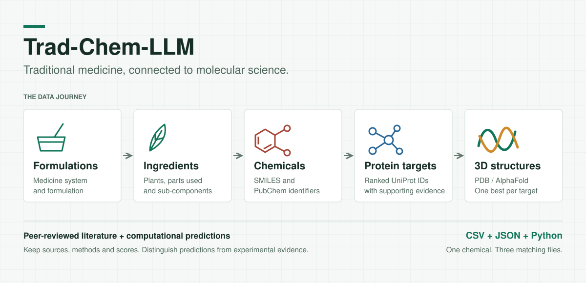

# Trad-Chem-LLM



**Trad-Chem-LLM** is a community-built database that connects **traditional medicine** to molecular
science: each traditional medicine is linked to its **plants**, the **chemicals** in those plants
(with SMILES), the **top 10 target proteins** of each chemical, and the biology around those proteins.

> **Want to add data? Read [contributions/CONTRIBUTING.md](contributions/CONTRIBUTING.md), then sign the table in
> [CONTRIBUTORS.md](CONTRIBUTORS.md).**
> Every chemical is submitted as **three files: CSV + JSON + Python**, inside its own folder under `tradchem/data/`.

> [!IMPORTANT]
> **Please do not push directly to `main`.**
> Create your own branch, add your data there, and open a **Pull Request** to `main`.
> Any size is welcome – one chemical or a whole formulation. A maintainer will review and merge it.
>
> ```bash
> git checkout -b <team-name>/<formulation>
> git push origin <team-name>/<formulation>   # then open a Pull Request on GitHub
> ```

---

## What the database holds

```
System → Formulation → Sub-component (plant) → Chemical (name + SMILES)
                                                    │
                                                    └─ Top 10 proteins (UniProt IDs, ranked, method, score)
                                                           ├─ best structure (PDB / AlphaFold / SWISS-MODEL id)
                                                           ├─ protein acronym
                                                           ├─ cell types
                                                           ├─ species
                                                           ├─ GO terms
                                                           └─ diseases (per protein, and per chemical)
```

| Data | Stored as |
|---|---|
| Traditional medicine, system (Ayurveda, Siddha, Unani, TCM …) | `traditional_medicine` |
| Plant scientific name, plant type, part used | `plant` |
| Chemical name, SMILES, PubChem CID | `chemical` |
| UniProt IDs each chemical hits (rank 1–10, method, score, source) | `chemical_protein` |
| Best PDB / AlphaFold / SWISS-MODEL id for each UniProt | `structure` |
| Protein acronym, species (NCBI taxon) | `protein`, `species` |
| Cell types | `cell_type`, `protein_cell_type` |
| GO terms | `go_term`, `protein_go` |
| Diseases | `disease`, `protein_disease`, `chemical_disease` |

The database is SQLite (`tradmed.db`). `v_full_record` is a ready-made view that flattens everything.

---

## Repository contents

```
Trad-Chem-LLM/
├── README.md
├── CONTRIBUTORS.md
├── contributions/
│   ├── CONTRIBUTING.md
│   └── check_submission.py
└── tradchem/data/
    └── <system>/                  e.g. ayurvedha
        └── formulations/
            └── <formulation>/
                └── <sub-component>/
                    └── <chemical>/
                        ├── <chemical>.csv
                        ├── <chemical>.json
                        └── <chemical>.py
```

| Path | What it is |
|---|---|
| `README.md` | This file |
| `CONTRIBUTORS.md` | Table where every contributor signs their name next to their contribution |
| `contributions/CONTRIBUTING.md` | Step-by-step contribution guide (**read first**) |
| `contributions/check_submission.py` | Checks that your CSV, JSON and Python files are valid and identical |
| `tradchem/data/` | All data, one folder per system / formulation / sub-component / chemical |
| `.../example-formulation-1/example-sub-component-1/curcumin/` | Worked example to copy |

---

## Quick start

```bash
# 1. clone and make your own branch
git clone https://github.com/INSTITUTE-OF-SCIENTIFIC-INFORMATICS/Trad-Chem-LLM.git
cd Trad-Chem-LLM
git checkout -b <team-name>/<formulation>

# 2. create your chemical folder and copy the example files into it, then fill them in
#    tradchem/data/<system>/formulations/<formulation>/<sub-component>/<chemical>/

# 3. check your three files agree
python3 contributions/check_submission.py tradchem/data/<system>/formulations/<formulation>/<sub-component>/<chemical>/<chemical>
```

No extra Python packages are needed.

---

## The one rule

**One chemical = one folder = three files with the same content**:

| File | Format |
|---|---|
| `<chemical>.csv` | spreadsheet, one row per protein |
| `<chemical>.json` | JSON, chemical once + a list of up to 10 proteins |
| `<chemical>.py` | Python, `CHEMICAL` + 10 `slot(...)` entries |

`check_submission.py` loads all three into separate throw-away databases and fails if they differ,
if any file is missing, or if example data or sources are left in.

---

## Data standards

- Every protein hit has a **source** (DOI, PMID, or database + date).
- IDs (UniProt, PDB, GO, taxon) are copied from the live databases, never guessed.
- "Top 10" is a **ranked** list; state how it was ranked (`method`, `score`).
- Exactly one **best structure** per protein.

Details and the full field reference are in [contributions/CONTRIBUTING.md](contributions/CONTRIBUTING.md).

---

## Maintainers

- Contact / issues: **[add maintainer name and contact]**
- Licence: **[add licence for the data and code]**
- How to cite: **[add citation text]**
